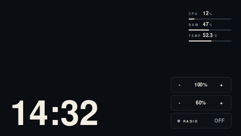

# TomTom XXL as a USB display + audio sink for a Raspberry Pi

Turn an old **TomTom ONE XXL IQ Routes** (Samsung S3C2412, 480×272 LCD) into a
small **external display / dashboard** — and a **remote speaker** — for a
Raspberry Pi, over the **USB cable only** (no WiFi, no video input).

The TomTom boots a minimal custom Linux (based on the [OpenTom] kernel), presents
itself to the Raspberry Pi as a **USB CDC-Ethernet gadget**, and the Pi streams
rendered frames to the TomTom (which blits them to `/dev/fb0`) and raw PCM audio
(which the TomTom writes to `/dev/dsp`).

```
   Raspberry Pi                          TomTom XXL IQ Routes
  ┌──────────────┐   USB cable   ┌──────────────────────────────┐
  │ dashboard.py │◄─────────────►│ g_ether (CDC-ECM gadget)     │
  │  (server)    │  TCP frames   │ tomdisp  ──► /dev/fb0 (480×272)│
  │  + ffmpeg    │  TCP PCM      │          ──► /dev/dsp (audio) │
  └──────────────┘◄──────────────│ touch events (LIGHT/VOL/RADIO)│
       192.168.1.1/32 host-route └──────────────────────────────┘
                                    192.168.1.10
```

## Screenshot



*The final dashboard (ink theme, no Immich photo): clock, CPU/RAM/TEMP and the
LIGHT / VOLUME / RADIO controls.*

## Features

* **Dashboard**: big clock, CPU / RAM / temperature (hot values turn coral),
  switched by a day/night schedule.
* **Backlight**: 20 / 50 / 100 % levels, manual with `−` / `+`, scheduled
  (100 % from 07:00 to 19:00, dim at night), from the Pi clock (no RTC on device).
* **Immich photo frame**: random photos from a self-hosted **Immich** server via
  its REST API, refreshed every N minutes. Photos are shown whole with a soft
  blurred fill on the sides (`PHOTO_FIT=blur`), or letterboxed / cropped.
* **Touch controls**: the resistive touchscreen sends taps to the Pi; `LIGHT` and
  `VOLUME` rows have `−` / `+` zones, `RADIO` toggles an internet radio.
* **Internet radio** (e.g. Radio Deejay): the Pi decodes the stream with `ffmpeg`
  and streams raw PCM to the TomTom; the volume is a software gain in 10 % steps.
* **Resilience**: heartbeat + automatic recovery. If USB is unplugged and
  replugged, the Pi brings `usb0` back up, detects the stale connection, restarts
  the TomTom's display server over telnet and resumes.

## Why this is non-trivial

* The stock TomTom firmware is a closed navcore and exposes **only USB mass
  storage**. There is no video input and no command API.
* The device's USB port is a **device port**; the stock Linux kernel has **no USB
  gadget/UDC support**, and when a PC is connected the device reboots into a
  bootloader mass-storage mode (no Linux running).
* The only way to get a live data channel is to **replace the firmware** with a
  Linux kernel that has the S3C UDC + `g_ether` gadget — what [OpenTom] provides.
* The framebuffer is a **double-buffered** 480×272 16 bpp surface; the visible
  page must be forced to page 0. The display server and the audio server must not
  both open the framebuffer.

So we build a **minimal** custom `ttsystem` (kernel + tiny initramfs), keep the
device's `ttsystem.orig` for recovery, and write our own framebuffer client and
Pi-side dashboard.

## Repository layout

```
client/     tomdisp.c          C client on the TomTom:
                               - serve  : /dev/fb0 sink, delta frames, touch
                               - play   : raw PCM -> /dev/dsp
                               - bright : set backlight
                               - beep   : tone test
                               - send / decode / gpsprobe / info / test
server/     dashboard.py       Pi renderer/streamer (PIL + numpy), touch handling,
                               Immich, radio, auto-recovery
            ttdisplay.service  systemd unit
            immich.env.example example environment file
firmware/   init               initramfs /init (RAM-only; see notes)
            mktt.c             packs (initramfs, zImage) -> ttsystem (TTBL)
            mkttimage-orig.c   upstream OpenTom packer (reference)
            crypto/            md5.c/h + blowfish.c/h (used by mktt.c)
            kernel.config      exact kernel .config used
            busybox.config     exact busybox .config used
            build.sh           end-to-end firmware build helper
docs/       notes.md           hardware / format / recovery notes
```

## Hardware

* TomTom **ONE XXL IQ Routes Edition** (hw type 42 / "Austin"), SoC **S3C2412**
  (ARM926EJ-S @264 MHz, 64 MB RAM), 480×272 16 bpp display, resistive touch
  (`tomtomgo-tsinput`, ABS_X/Y + ABS_PRESSURE, axes inverted), 2 GB internal
  flash (no SD slot), no Bluetooth, no light sensor.
* **Raspberry Pi** (any modern model; tested on Pi 4). The Pi is the USB host.

## Firmware (TomTom side)

The firmware is the TomTom GPL kernel `linux-s3c24xx` (2.6.13) with the OpenTom
patch, built with the old TomTom toolchain (gcc 3.3.4, i386-hosted — run it under
`qemu-i386` on an arm64 Pi). `build.sh` automates this.

Key kernel options (see `firmware/kernel.config`):

```
CONFIG_ARCH_S3C2410=y
CONFIG_MACH_TOMTOMGO=y
CONFIG_USB_GADGET=y
CONFIG_USB_GADGET_S3C_FS=y
CONFIG_USB_ETH=m           # g_ether.ko
CONFIG_INITRAMFS_SOURCE="firmware/initramfs"   # initramfs embedded in kernel
CONFIG_FRAMEBUFFER_CONSOLE=y
CONFIG_CMDLINE_OVERRIDE=y
CONFIG_CMDLINE="console=tty0"
```

The bootloader passes no initrd and there is no `root=`, so the **initramfs is
embedded into the zImage**. `/init` is a shell script with shebang
`#!/bin/busybox sh` (there is no `/bin/sh` in the cpio yet) — a subtle but fatal
detail. It also silences kernel printk (`/proc/sys/kernel/printk = 0`) so kernel
messages do not paint text over the dashboard.

`/init` **does not mount the internal FAT**: at boot the MMC can probe late and a
mount attempt can stall and starve userspace. `tomdisp` runs from the initramfs
(RAM) instead — reliable. Mount the FAT on demand over telnet only when you want
to update the client:

```sh
mknod /dev/mmcblk0 b 250 0
mount -t vfat -o rw,exec /dev/mmcblk0 /mnt/sdcard
# copy the new tomdisp, sync, reboot
```

Only `/bin/tomdisp serve` opens the framebuffer. `/bin/tomdisp play` is audio-only
(it never touches `/dev/fb0`); opening the framebuffer from two processes hangs
the display.

### ttsystem format (reverse engineered)

```
"TTBL" | kernel_size u32 | kernel_addr=0x31700000 | zImage | sig16
       | root_size   u32 | root_addr=0x31000000   | cpio.gz | sig16
       | start_seq[12] = 00 00 00 00  00 00 70 31  00 00 00 30
```

The bootloader loads each blob **by address** and jumps to `0x31700000`. `sig16`
is MD5+Blowfish (see `firmware/crypto`, key from `mktt.c`). `mktt.c` writes
kernel-first, matching the stock image.

Flash = copy `ttsystem` to the root of the TomTom's internal FAT (keep
`ttsystem.orig`). To recover from a bad image: power-cycle the device while
connected; the bootloader exposes the FAT as mass storage again.

## Server (Raspberry Pi side)

`dashboard.py` renders a 480×272 RGB565 frame, diffs it against the previous
frame and sends **only changed rows as rectangles** (delta), plus backlight
commands. It also handles touch events, Immich, the radio and auto-recovery.
Requires `python3-pil`, `python3-numpy`, `ffmpeg`.

Install:

```bash
sudo cp server/ttdisplay.service /etc/systemd/system/
sudo cp server/immich.env.example /home/pi/ttbuild/immich.env   # edit it
sudo systemctl enable --now ttdisplay.service
```

The service loads `/home/pi/ttbuild/immich.env` (URL, API key, intervals) and
runs as an unprivileged user; `ExecStartPre` brings `usb0` up as root.

The Pi's `usb0` must reach the TomTom. Use a **`/32` address + host route** so a
LAN on `192.168.1.0/24` is not hijacked:

```bash
sudo nmcli con add type ethernet ifname usb0 con-name ttdisp \
  ipv4.method manual ipv4.addresses 192.168.1.1/32 \
  ipv4.routes "192.168.1.10/32" ipv4.never-default yes
sudo nmcli con up ttdisp
```

### Environment (immich.env)

```
IMMICH_URL=http://your-immich-host:2283
IMMICH_KEY=your-api-key
IMMICH_INTERVAL=180          # seconds between photos
PHOTO_FIT=blur               # blur | contain | cover
BRIGHT_NIGHT=10
STATS_EVERY=5
RADIO_URL=https://.../master_ma.m3u8
```

## Protocol

### Display (TCP :5555, Pi → TomTom)

Each message starts with a `u32` tag:

| tag                 | payload                                                        |
|---------------------|----------------------------------------------------------------|
| `0xFFFFFFFF`        | `u8 cmd, u8 val` (cmd 1 = backlight; cmd 0 = heartbeat/no-op)  |
| `0xEEEEEEEE`        | `u16 nrect`, then per rect `4×u16 x,y,w,h` + `w*h*2` RGB565     |
| any other value `N` | full frame: `N` bytes RGB565                                   |

On connect the TomTom sends a 12-byte handshake: `6×u16` = `xres, yres, bpp,
line_length, 0, 0`.

### Touch (TomTom → Pi, same socket)

A tap is sent as `u32 magic = 0x43554F54` ("TOUC"), `u32 x`, `u32 y` (screen
coordinates, axes already calibrated/inverted in `tomdisp`).

### Audio (TCP :5556, Pi → TomTom)

Raw PCM `s16le`, 44100 Hz, stereo. The Pi decodes the radio with `ffmpeg` and
applies the volume as a software gain.

## Reliability

* **Heartbeat** every 5 s on the display socket, so the TomTom's single-client
  server notices dead connections.
* **Full redraw every 30 s** (also clears any stray console text).
* **Auto-recovery**: if connect/handshake fails, the Pi opens a telnet session to
  the TomTom and restarts `serve` + `play`, then reconnects. `usb0` is re-raised
  by `ExecStartPre` on every service start.
* Unplug/replug the USB and the dashboard comes back in ~15–30 s.

## Known limitations

* **GPS**: the GL/Barracuda chip needs the original navcore bring-up; `glgps`
  starts but `/dev/gps` returns `EIO` in this minimal environment. Not used.
* **Bluetooth / light sensor / SD slot / FM transmitter**: absent on this model.
* **USB**: full-speed (12 Mbit/s), so the display is a low-refresh dashboard
  (~15 fps max with deltas), not video.

## Credits & license

* Kernel: TomTom GPL release (`linux-s3c24xx`, GPLv2).
* [OpenTom] — kernel patch, gadget config, `mkttimage`, packaging approach.
* `mkttimage.c` by Thomas Kleffel / Matthias Kleffel / Christian Daniel (GPLv2),
  included for reference; `crypto/*` from OpenTom.
* The rest (tomdisp, dashboard, init, build glue) is original.

Licensed under the **GNU GPL v2** (see `LICENSE`).

[OpenTom]: https://github.com/george-hopkins/opentom
